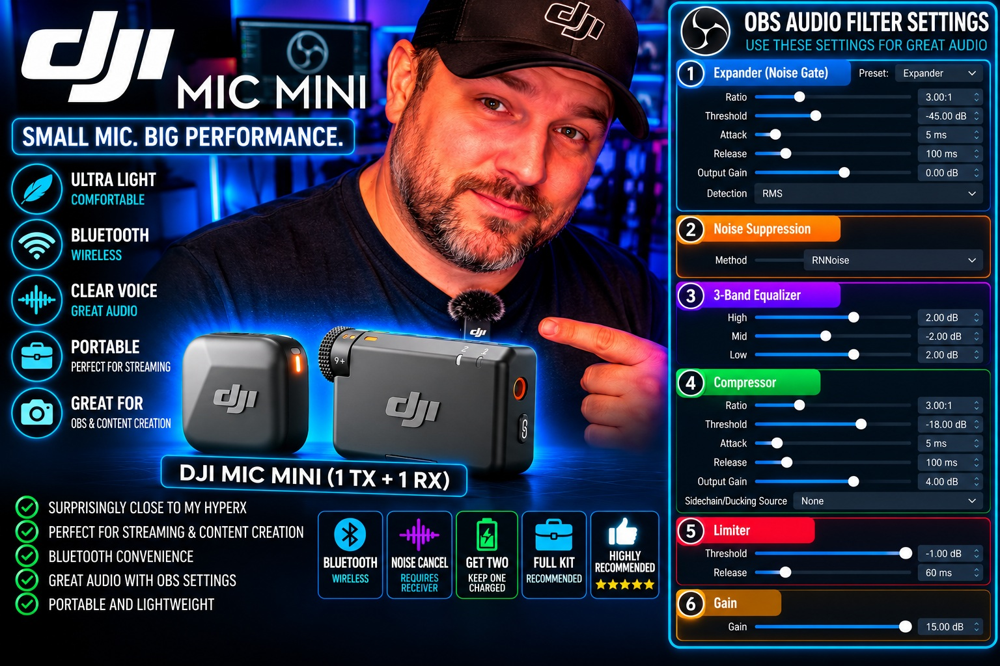

# DJI Mic Mini + OBS Studio: Real-World Setup, Honest Review & Buying Guide

> **A real-world guide for streamers, podcasters, and creators.** Tested settings, practical troubleshooting, and transparent product links—without pretending every product is perfect.

## Product gallery

See the exact products discussed in this guide. Images are stored in this repository; prices and availability on Amazon may change. Affiliate links are labeled as paid links.

| Product | Image | Details |
|---|---|---|
| DJI Mic Mini Transmitter (Infinity Black) — transmitter only |  | **Screenshot price: $25** · [Amazon (paid link)](https://amzn.to/4igSLC1) |
| DJI Mic Mini (1 TX + 1 RX) |  | **Screenshot price: $45** · [Amazon (paid link)](https://amzn.to/4s6vy9g) |
| DJI Mic Mini (2 TX + 1 RX + Charging Case) |  | **Screenshot price: $79** · [Amazon (paid link)](https://amzn.to/4hWh72L) |
| DJI Mic Mini Transmitter (Arctic White) — transmitter only |  | **Screenshot price: $25** · [Amazon (paid link)](https://amzn.to/3TBwDJr) |
| DJI Mic Mini (2 TX + 1 RX) |  | **Screenshot price: $59** · [Amazon (paid link)](https://amzn.to/4zo6WLo) |
| DJI Mic Mini Mobile Phone Adapter (Lightning) |  | **Screenshot price: $19** · [Amazon (paid link)](https://amzn.to/47iCIxv) |
| DJI Mic Series Mobile Receiver (DMMR02) |  | **Screenshot price: $15** · [Amazon (paid link)](https://amzn.to/4hJP6wt) |

> Product photos are for identification. The price labels reflect screenshots supplied during preparation, not a live price check. Confirm exact kit contents, seller, return policy, warranty, and checkout total before buying. The DMMR02 mobile receiver requires its own **DJI Mic Series Mobile Receiver Adapter (USB-C to Lightning)** for Lightning iPhones; it is not compatible with the older DJI Mic Mini Lightning adapter shown above.

---

## Our promise: honest reviews first

This guide is built around real-world experience with the DJI Mic Mini and OBS Studio. Affiliate links help support the time spent testing, documenting, and maintaining guides, but they do **not** buy a positive review.

- We separate firsthand testing from research.
- We disclose affiliate links clearly.
- We do not claim to have tested products we have not tested.
- We do not call a product “the cheapest” without a current comparison.
- We do not call a seller “trusted” just because a listing looks professional.
- We update recommendations when better evidence or a better-value option appears.

**Affiliate disclosure:** Some links on this page are Amazon affiliate links. If you purchase through them, I may earn a commission at no additional cost to you. That helps support independent guides and my family, and it does not change my conclusions.

**As an Amazon Associate I earn from qualifying purchases.**

Any affiliate link should be marked near the link itself as **(paid link)**. Prices, availability, shipping dates, and seller details can change; confirm the final details on the retailer's checkout page.

---

## Contents

- [Quick verdict](#quick-verdict)
- [What I tested and what I learned](#what-i-tested-and-what-i-learned)
- [My DJI Mic Mini OBS settings](#my-dji-mic-mini-obs-settings)
- [OBS filter chain](#obs-filter-chain)
- [Audio level targets](#audio-level-targets)
- [Mic placement and everyday use](#mic-placement-and-everyday-use)
- [Phone and Lightning adapter compatibility](#phone-and-lightning-adapter-compatibility)
- [My DJI Mic Mini Setup & Upgrade Plan](#my-dji-mic-mini-setup--upgrade-plan)
- [Gear links](#gear-links)
- [How we compare prices and sellers](#how-we-compare-prices-and-sellers)
- [AI-assisted buying guides](#ai-assisted-buying-guides)
- [Troubleshooting](#troubleshooting)
- [Who should buy it?](#who-should-buy-it)
- [Frequently asked questions](#frequently-asked-questions)
- [Sources and update policy](#sources-and-update-policy)

## Quick verdict

The DJI Mic Mini is a tiny wireless microphone system that can work well for streaming, video, interviews, and mobile content. In my OBS setup, careful filtering made its sound impressively close to my HyperX SoloCast desk microphone for the kind of content I create.

That does **not** mean it wins every category. A USB desk microphone is always ready at the desk and does not need a wireless transmitter to be charged and clipped on. A wireless mic is much easier to move around with, and can be more discreet on camera.

### My short recommendation

- **Mostly seated at a desk?** Keep a good USB microphone in the running. It may be simpler.
- **Moving around, streaming, filming, or recording conversations?** The Mic Mini is worth considering.
- **Want to use it with OBS on a PC?** Use the receiver over USB and configure OBS deliberately.
- **Want to use it with a Lightning iPhone?** You need the specific DJI Mic Mini Lightning phone adapter for the Mic Mini receiver. Check compatibility before buying; adapters for other DJI Mic generations are not interchangeable.
- **Need two people on mic?** Check the kit contents carefully. The two-transmitter kit includes two TX units, one RX, and a charging case. A second transmitter does not mean you have a second receiver.

## What I tested and what I learned

This section describes my experience, not a laboratory benchmark.

### What worked well

- The transmitter is small, light, and discreet.
- The black finish looks clean on camera.
- With OBS filters tuned for my voice and room, the sound came surprisingly close to my HyperX SoloCast for my streaming use.
- Using the RX receiver with the PC has stopped the connection problem I experienced during my earlier transmitter-only Bluetooth setup.
- The wireless setup is more flexible than being tethered to a desk microphone.

### What was less convenient

- My initial transmitter-only Bluetooth setup did not provide the complete receiver-based workflow I wanted.
- That early Bluetooth setup sometimes lost its connection in OBS and required a computer restart or signing out and back in. After I started using the RX receiver with the PC, that issue stopped.
- Wireless transmitters need battery management. Keep an eye on charge and have a backup plan for long sessions.
- A wireless mic requires more setup than simply talking into a desk USB mic.

### Fair comparison: DJI Mic Mini vs. HyperX SoloCast

| Category | DJI Mic Mini | HyperX SoloCast |
|---|---|---|
| Mobility | Excellent for moving around | Best when used at a desk |
| Discreet on-camera look | Small transmitter | Visible desk microphone |
| Battery management | Transmitter needs charging | USB-powered |
| Setup | Wireless receiver and OBS configuration | Usually straightforward USB setup |
| My OBS sound result | Impressively close after tuning | Strong desk-mic reference |
| Best fit | Mobile content, streaming, interviews | Desk-first streaming and recording |

This is a practical personal comparison, not a claim that one microphone wins every voice, room, or recording setup.

## My DJI Mic Mini OBS settings

These are the settings used in my setup. Treat them as a starting point, not universal values. Your voice, room noise, mic distance, Windows input level, and OBS version can all change the best settings.

### Device and audio settings

1. Connect the DJI Mic Mini **receiver (RX)** to the PC by USB.
2. In OBS, open **Settings → Audio**.
3. Set the sample rate to **48 kHz**.
4. Set channels to **Stereo** if that suits your routing.
5. Select the DJI receiver as the relevant **Mic/Auxiliary Audio** input.
6. Disable unused Desktop Audio devices if you do not need them. Keep any desktop audio source you actually use.
7. In Windows sound settings, turn off audio enhancements or communications ducking if they are causing level changes. In OBS, enable **Disable Windows audio ducking** if that option is available in your version.
8. Make a short test recording and listen back with headphones before going live.

### Receiver and transmitter setup

- **RX receiver output mode:** Stereo.
- **TX transmitter noise cancellation:** ON for the setup described here. The transmitter indicator appears orange when noise cancellation is enabled.
- **Receiver output level:** I used **+12** where that control was available.
- Keep the transmitter close enough to the mouth for a strong voice signal, and avoid rubbing the mic against clothing.

Noise cancellation is not a substitute for a quiet room or good mic placement. It can also change the character of a voice, so listen to a recording and choose the mode that sounds best for your environment.

## OBS filter chain

My working OBS chain is:

1. **RNNoise Noise Suppression**
2. **Expander**
3. **3-band EQ**
4. **Compressor**
5. **Gain**
6. **Limiter**

OBS filter order matters. Start with the values below, record a sample, and adjust one filter at a time.

| Filter | Starting settings used in my setup | Purpose |
|---|---|---|
| RNNoise | Noise suppression method: RNNoise | Reduces steady background noise |
| Expander | Ratio **3:1**, threshold **-45 dB**, attack **5 ms**, release **100 ms**, output gain **0 dB**, detection **RMS** | Reduces quieter room noise between phrases |
| 3-band EQ | High **+2 dB**, Mid **-2 dB**, Low **+2 dB** | Adds a little presence and body for my voice |
| Compressor | Ratio **3:1**, threshold **-18 dB**, attack **5 ms**, release **100 ms**, output gain **+4 dB** | Controls louder phrases and evens out speech |
| Gain | **+15 dB** in my later setup | Raises the signal after earlier processing |
| Limiter | Threshold **-1 dB**, release **60 ms** | Helps prevent peaks from clipping |

**Important:** These are my personal starting values, not a promise that the same chain will sound good for everyone. A +15 dB gain filter is substantial. If your signal is already loud or noisy, lower the gain instead of copying the number blindly. If audio sounds harsh, pumping, distorted, or overly processed, reduce the processing and test again.

### How to tune the chain

- Speak at your normal streaming volume, not your loudest possible voice.
- Listen for words being cut off at the beginning or end; if that happens, adjust the expander threshold and release.
- If the noise suppression creates watery or robotic artifacts, try a less aggressive approach or improve the room noise first.
- If the compressor makes the noise floor rise between words, reduce its output gain or adjust the expander.
- Use the limiter as a safety net, not as a replacement for sensible input gain.
- Record a 30–60 second sample with normal speech, louder speech, and a pause. Listen back on headphones.

## Audio level targets

Use OBS's meter and your ears together. Exact levels depend on the source and processing, but a practical speech starting point is:

- Normal speech peaks often around **-18 to -10 dBFS** before final loudness processing.
- Louder phrases can peak higher while leaving headroom.
- Avoid repeated peaks at **0 dBFS**; digital clipping sounds harsh and cannot be fixed by lowering the volume afterward.
- A limiter near **-1 dB** can help control peaks, but it cannot repair clipping that happened earlier in the signal chain.

If the meter is too low, first check the receiver output, Windows input level, and mic placement. Avoid adding large amounts of gain until you know where the signal is getting lost.

## Mic placement and everyday use

- Clip the transmitter securely around upper-chest level, with the mic opening unobstructed.
- Keep it away from necklaces, hair, loose fabric, and anything that can rub against it.
- Test your head turns and normal movement; clothing noise can be more noticeable than room noise.
- Use the included magnet and compatible mounting accessories as intended. Check that the magnet is secure before moving around.
- Do a quick sound check before every important stream or recording.
- Charge the transmitter before a long session and keep a known-good backup mic available if possible.

## Compact phone setup: DJI Mic Series Mobile Receiver (DMMR02)

I bought the **DJI Mic Series Mobile Receiver (model DMMR02)** to make the phone connection smaller and more convenient. The screenshot I checked showed **$15.00**; prices and stock can change, so confirm the current listing before ordering.

**Amazon link — paid link:** [DJI Mic Series Mobile Receiver (DMMR02)](https://amzn.to/4hJP6wt)

This is a separate mobile receiver that plugs directly into a phone's USB-C port. It supports compatible DJI Mic Mini transmitters and can connect up to two transmitters. For an iPhone with a Lightning port, it requires the **DJI Mic Series Mobile Receiver Adapter (USB-C to Lightning)**.

**Important adapter warning:** The adapter linked in the next section—DJI Mic Mini Mobile Phone Adapter (Lightning), `https://amzn.to/47iCIxv`—is for the standard DJI Mic Mini receiver. DJI says it is **not compatible** with the newer DJI Mic Series Mobile Receiver (DMMR02). Do not buy the two accessories assuming they work together. Use the adapter specifically named **DJI Mic Series Mobile Receiver Adapter (USB-C to Lightning)** for the DMMR02.

Your screenshot showed the mobile receiver sold by **BOUNDLESS OCEAN** and shipped by Amazon. That alone does not prove the seller is or is not authorized. Check current seller details, condition, warranty, return terms, and the exact model before buying.

This is a compact-phone workflow, not a claim that I have tested every phone or app combination. Check official compatibility information for your exact phone and recording app.

## Phone and Lightning adapter compatibility

For a compatible iPhone with a Lightning port using the **standard DJI Mic Mini receiver**, the relevant accessory is the **DJI Mic Mini Mobile Phone Adapter (Lightning)**. It connects that receiver to compatible Lightning iPhones for audio recording. It is not the correct adapter for the newer DJI Mic Series Mobile Receiver (DMMR02); see the separate mobile receiver section above.

**Amazon link — paid link:** [DJI Mic Mini Lightning adapter](https://amzn.to/47iCIxv) — your screenshot showed $19.00. The Amazon listing showed BOUNDLESS OCEAN as the seller and Amazon as the shipper; check the current listing and seller details before ordering.

Before ordering:

- Confirm that the listing is specifically for the **DJI Mic Mini receiver**.
- Check your exact iPhone model and Lightning connector.
- Do not assume an adapter made for the original DJI Mic, DJI Mic 2, or another receiver is interchangeable.
- Verify the seller, condition, delivery estimate, return terms, and final price at checkout.

DJI's product information lists the Mic Mini Lightning phone adapter as a separate accessory. Compatibility is model-specific, so consult the manufacturer's compatibility information if anything in a listing is unclear.

## My DJI Mic Mini Setup & Upgrade Plan

My goal is to avoid constantly swapping one receiver between my PC and phone.

1. **PC/OBS receiver:** Keep my current DJI Mic Mini RX connected to the PC for streaming and recording.
2. **Phone receiver:** Obtain a second compatible receiver for the Lightning adapter so the mobile setup can stay ready.
3. **Compare the actual total cost:** Check a genuine receiver-only replacement against **one complete additional DJI Mic Mini kit** with a transmitter and charging case. Do not buy two complete kits just to solve the receiver-swapping problem.
4. **Consider the extra transmitter:** A second TX can be useful for two-person conversations or podcast-style recording and can help with charging rotation. It still needs charging; a second receiver does not eliminate transmitter battery management.
5. **Verify before buying used:** Confirm exact model, working condition, compatibility, return options, and whether accessories are included. Ask for a photo of the actual item and its model/label where appropriate.

This is a plan, not a claim that I have already bought or tested the additional receiver or kit.

## Gear links

The following seven Amazon affiliate links are included. Product names are matched to the screenshots supplied; screenshot prices are historical snapshots, not live price guarantees. Confirm the current product, seller, contents, and checkout total before purchasing.

1. **DJI Mic Mini Transmitter (Infinity Black) — transmitter only** (paid link): [Buy/check the transmitter on Amazon](https://amzn.to/4igSLC1). This is the single TX unit, not a receiver or a complete microphone kit. In the screenshot you supplied, Amazon displayed $25.00; price, stock, and delivery can change. A compatible DJI Mic Mini receiver is needed for the usual receiver-based OBS setup, and the transmitter-only purchase should not be mistaken for a complete kit.
2. **DJI Mic Mini (1 TX + 1 RX) — single-transmitter kit with receiver** (paid link): [Buy/check the DJI Mic Mini 1 TX + 1 RX kit on Amazon](https://amzn.to/4s6vy9g). Your screenshot showed $45.00 at the time it was captured; prices, stock, and delivery can change. This kit includes one transmitter (TX) and one receiver (RX), unlike Product Link #1, which is a transmitter only. Check the exact box contents and seller before ordering.
3. **DJI Mic Mini (2 TX + 1 RX + Charging Case)** (paid link): [Buy/check the two-transmitter kit on Amazon](https://amzn.to/4hWh72L). This kit is listed with two transmitters, one receiver, and a charging case. Your screenshot showed $79.00 at the time it was captured; price and delivery may change. The listing screenshot showed “Ships from Amazon” and “Sold by Hibikin-US,” so check seller details, warranty, condition, and return terms rather than assuming the seller is DJI or an authorized dealer.
4. **DJI Mic Mini Transmitter (Arctic White) — transmitter only** (paid link): [Buy/check the Arctic White transmitter on Amazon](https://amzn.to/3TBwDJr). This is a single transmitter, not a receiver or complete microphone kit. Your screenshot showed $25.00 and the seller as Hibikin-US, with Amazon shipping the item. That does not by itself confirm DJI-authorized status; check the warranty, condition, returns, and final checkout price.
5. **DJI Mic Mini (2 TX + 1 RX) — two transmitters, one receiver** (paid link): [Buy/check the two-transmitter kit on Amazon](https://amzn.to/4zo6WLo). Your screenshot showed $59.00 for this configuration, with the seller listed as Hibikin-US and Amazon shipping the item. This listing appears to be the 2 TX + 1 RX configuration without the charging case shown in the separate $79 kit; verify the exact box contents on the live listing before ordering. Check warranty, condition, return terms, and final checkout price.

6. **DJI Mic Mini Mobile Phone Adapter (Lightning)** (paid link): [Check the adapter on Amazon](https://amzn.to/47iCIxv). Your screenshot showed $19.00, with BOUNDLESS OCEAN listed as seller and Amazon as shipper. Confirm current price, compatibility, warranty, condition, and return terms.
7. **DJI Mic Series Mobile Receiver (DMMR02)** (paid link): [Check the mobile receiver on Amazon](https://amzn.to/4hJP6wt). Your screenshot showed $15.00 and listed BOUNDLESS OCEAN as seller, with Amazon shipping. This compact USB-C mobile receiver is intended to reduce the bulk of using a separate receiver-and-adapter combination on a compatible phone. For Lightning iPhones, it needs the separate **DJI Mic Series Mobile Receiver Adapter (USB-C to Lightning)**; the older Mic Mini Lightning adapter in link #6 is not compatible.

**Editorial rule:** Never publish a product title beside a link until the destination has been checked. A link should match the product pictured and described, including the exact model and connector.

## How we compare prices and sellers

We want to help readers find good value—not just the lowest number on the page.

When comparing an item, record:

- **Date checked:** Prices and availability change.
- **Exact model and contents:** Confirm whether it is a single accessory, one-transmitter kit, or two-transmitter kit.
- **Total delivered cost:** Item price, shipping, tax, and any required accessories.
- **Seller identity:** Prefer the manufacturer or an established authorized retailer when practical.
- **Condition:** New, refurbished, used, open-box, or replacement part.
- **Return policy and warranty:** Check who handles returns and whether manufacturer warranty applies.
- **Delivery estimate:** Use the actual checkout estimate for your location; do not promise a date from a search result.
- **Evidence:** Save the product page and seller details on the date checked.

### Seller trust checklist

Before recommending a seller, look for:

- A clear business identity and contact information.
- Consistent product and model details.
- A reasonable, published return policy.
- Transparent condition and warranty terms.
- A meaningful history of independent customer feedback.
- A checkout page that clearly identifies who sells and ships the item.

Marketplace labels like “ships from” and “sold by” can refer to different companies. Read both. A low price is not proof of a scam, but a suspiciously low price, vague model description, no return policy, or pressure to pay off-platform are reasons to pause.

We cannot guarantee that a seller is trustworthy or that a parcel will arrive safely. We can document the evidence and explain the remaining uncertainty.

## AI-assisted buying guides

AI can help compare products, organize specifications, summarize manufacturer documentation, and flag inconsistencies. It cannot replace hands-on testing or independently guarantee a seller's honesty.

For each future buying guide, we will label evidence clearly:

- **Personally tested:** I used the exact product in my own setup.
- **Manufacturer specifications:** Information from official documentation.
- **Independent research:** Comparisons from credible third-party sources.
- **Not yet tested:** A researched option that has not been personally evaluated.
- **Price checked on:** The date the listing and total cost were reviewed.

### Our comparison method

1. Confirm the exact model and compatibility.
2. Read the manufacturer's documentation first.
3. Compare current delivered prices from Amazon and reputable alternatives.
4. Check the actual seller, condition, warranty, returns, and shipping estimate.
5. Look for recurring complaints in independent reviews, while remembering that reviews can be incomplete or biased.
6. Explain who the product suits, who should skip it, and what cheaper or simpler alternatives exist.
7. Disclose affiliate links near each recommendation.
8. Recheck time-sensitive prices before stating that an item is the best deal.

**No fabricated testing, fake testimonials, guaranteed-delivery promises, or unsupported “best on the market” claims.** If the evidence is incomplete, the guide will say so.

## Troubleshooting

### OBS does not show the DJI receiver

- Confirm that the RX is powered and connected over USB.
- Try a known-good USB cable and another USB port.
- Check Windows sound input devices.
- Re-select the receiver in OBS under **Settings → Audio** or the relevant audio source properties.
- If the receiver is not visible to Windows, solve that connection problem before changing filters.

### Audio is too quiet

- Check the receiver's output setting and Windows input level.
- Check that the correct source is selected in OBS.
- Confirm the transmitter is positioned close enough to your mouth.
- Temporarily bypass filters to find out whether a filter is reducing the level.
- Increase gain in small steps and listen for hiss or distortion.

### Audio is distorted or clips

- Reduce receiver or input level if the source is already too hot.
- Reduce the OBS Gain filter.
- Check compressor output gain and limiter placement.
- Make a fresh recording and inspect the loudest sections.
- Do not try to fix a clipped recording by simply turning it down afterward.

### Voice sounds robotic or watery

- Test RNNoise off briefly to compare.
- Improve the room environment and reduce the noise at its source.
- Avoid stacking overly aggressive noise reduction with a harsh expander.
- Adjust one filter at a time.

### OBS connection trouble

My early transmitter-only Bluetooth configuration sometimes lost connection. With the RX receiver connected to my PC, that issue stopped. If you use a different configuration and experience dropouts, test with the receiver over USB, a different cable/port, and a short recording before a live session.

### Phone adapter does not fit or work

- Confirm it is the DJI Mic Mini Lightning adapter, not an adapter for a different DJI Mic generation.
- Confirm your phone has a Lightning port and that the receiver model is compatible.
- Check the product listing and official compatibility documentation before buying a replacement.

## Who should buy it?

### Good fit

- Streamers and creators who want a small wireless mic.
- People recording interviews or conversations.
- Creators who move around during filming.
- People who want one microphone system that can support PC and compatible phone workflows with the right receiver/adapter.

### Think twice if…

- You mostly sit at a desk and already own a USB mic you like.
- You do not want to manage wireless transmitter charging.
- You need a specific mobile connection but have not verified receiver/adapter compatibility.
- You expect noise cancellation to remove every sound in every environment.
- You need an all-in-one dual-person setup but are looking at a one-transmitter kit.

## Frequently asked questions

### Does the DJI Mic Mini replace a USB desk mic?

It can for many workflows, but it depends on how you work. In my OBS setup, the Mic Mini sounded impressively close to my HyperX SoloCast after tuning. A USB mic is still simpler for desk-only use and does not require transmitter charging.

### Should I use Bluetooth or the receiver with OBS?

My preferred PC setup is the receiver connected over USB. My earlier transmitter-only Bluetooth setup had occasional connection problems; using the receiver with the PC stopped that issue for me.

### Are the OBS filter settings universal?

No. They are starting points from my own setup. Room noise, voice, mic distance, device gain, and filter order all matter. Make a recording and tune by listening.

### Does the Lightning adapter come with every kit?

Do not assume it does. DJI lists the Mic Mini Lightning adapter separately in its accessory information, and kit contents vary. Check the exact box contents before ordering.

### Can I trust the cheapest online seller?

Price alone cannot answer that. Check who sells and ships the item, condition, warranty, return terms, seller history, model compatibility, and delivered cost. If the evidence is unclear, choose a better-documented seller or do not recommend the listing.

### Do affiliate commissions affect the verdict?

They should not. The disclosure tells readers that a commission may be earned. Product conclusions remain based on actual experience and the available evidence. If a product has a drawback, we include it.

## Sources and update policy

Official documentation is the first stop for compatibility and product specifications:

- [DJI Mic Mini official product page](https://www.dji.com/mic-mini)
- [DJI Mic Mini support and FAQ](https://www.dji.com/support/product/mic-mini)
- [DJI Mic Mini Mobile Phone Adapter (Lightning)](https://store.dji.com/mc/product/dji-mic-mini-phone-adapter-lightning)
- [Amazon Associates disclosure requirements](https://affiliate-program.amazon.com/help/node/topic/GHQNZAU6669EZS98)
- [FTC guidance on endorsements and affiliate links](https://www.ftc.gov/business-guidance/resources/ftcs-endorsement-guides-what-people-are-asking)

**Last reviewed:** October 13, 2026

We will update this guide when settings change, new firsthand tests are completed, compatibility information changes, or a meaningful price/value comparison is available. Price claims should always include the date checked. Recommendations may change when the evidence changes.

---

*Built for creators who want useful gear advice, honest testing, and transparent links. Thanks for supporting independent work and helping keep practical guides available.*
